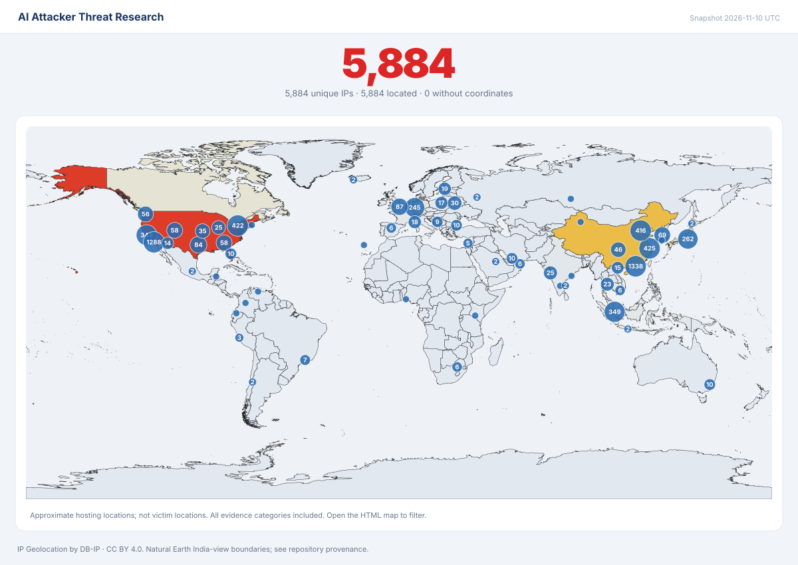

# AI Attacker Threat Research

Research into the abuse of AI offensive frameworks and AI-assisted malware development, with sources, dates, scoped confidence and reproducible static evidence. Snapshot: **13 November 2026**.

## IP overview and map

[**Live interactive map**](https://ella-bakshi.github.io/ai-attacker-threat-research/) · [**Main IP CSV**](data/ip-overview.csv) · [JSON](data/ip-overview.json) · [Enrichment and automatic updates](docs/enrichment-and-map.md)

The main CSV contains IP, source-observation timestamp, ASN, hosting/network organization, location and a documented confidence score. The map separates passive deployment leads, campaign infrastructure and our derivations. Hosting geography is separate from India targeting; scores express evidence strength, not a maliciousness probability. The [coverage snapshot](data/enrichment/summary.json) records matched and unmatched enrichment.

The inventory total counts unique IP addresses across evidence classes. It does not count active AI agents, successful attacks or systems targeting a particular country.

## Tool index

[**33 verified project identities and resources**](tools/README.md), including ten added on 13 November: capabilities, official sources/fork lineage, releases, license qualifications, AI features and scoped abuse evidence. Early releases and adjacent general agents remain labeled. [Our two source identification hypotheses](tools/source-identification-hypotheses.json) are runtime-untested software research, separate from admitted IOCs.

## Our findings

New: [VoidLink sample defaults and native evidence](research/analyst-derived/2026-11-13-voidlink/README.md), separately scoped from the historical 342-record collection.

We derived or verified **342 records**, including byte/native-backed configuration from an acquired CyberStrikeAI-lineage beacon and ten additional conditional host/protocol patterns. These records include software/reference fingerprints; they are not all confirmed malicious IOCs, and no global novelty is claimed.

- [Our derived observations](research/analyst-derived/all-derived-observables.csv)
- [Acquired beacon analysis and evidence](research/analyst-derived/2026-11-10-cyberstrikeai-elf/README.md)
- [Detection rules](detections/README.md): 12 YARA rules and one explicitly experimental Sigma rule

The sample's exact operator, named campaign, India targeting and current live C2 remain unknown. Static capability does not prove execution on a victim.

Additional independently verified India-campaign observations are in [our separate static analysis](india/additional-ai-campaigns/2026-11-10-independent-static-analysis/README.md) and [own-observation CSV](india/additional-ai-campaigns/analyst-derived.csv): **5 records**, with vendor-reported campaign context and our byte/method evidence kept distinct.

The [independent enrichment supplement](independent-enrichment/README.md) adds **16 separately scoped records** from public sandbox, certificate and historical scan artifacts: six derived facts, two TLS fingerprints, two unverified sibling domains and six shared-CDN contexts. It corroborates 80 check-in attempts to an existing configured IP; it does not add a verified India-specific C2. [Own observations CSV](independent-enrichment/observations.csv).

We also performed [two first-party endpoint observations](research/first-party/README.md): one root GET per existing seed, with DNS/TLS/HTTP evidence. HTTP 521 and 404 are point-in-time responses, not functioning-C2 proof. These measurements remain separate from provider data and the incident lists. [How our collection works](docs/our-enrichment-workflow.md) · [Hunt's public methods and supported private exports](docs/hunt-and-independent-methods.md).

[ARTEX reachability and fork qualifications](tools/artex-source-review.md) refine our static enrichment markers and a historical authentication realm; source presence is separate from observed traffic.

## Sourced IOCs

The main incident lists contain **18 ARTEX-associated** and **9 CyberStrikeAI-associated** indicators reported by external sources. Every record retains role, source, dates, confidence scope and verification status. Supporting tools, software fingerprints, passive sightings and unresolved claims remain separate.

- [ARTEX incident indicators](frameworks/ARTEX/README.md)
- [CyberStrikeAI incident indicators](frameworks/CyberStrikeAI/README.md)
- [Research appendices](research/README.md)
- [Compact research catalog](data/catalog.csv) and [master union](data/ALL-FOUND-master.csv): 15,349 distinct type/value records across evidence classes, not a count of malicious systems

## India-related evidence

“Targeting India” refers to the victims or campaign target selection, regardless of infrastructure hosting country. The [dedicated C2 infrastructure view](india/C2-INFRASTRUCTURE.md) contains **18 source-reported C2 records**, with [delivery infrastructure](india/delivery-infrastructure-targeting-india.csv) and [backup configuration resources](india/c2-configuration-resources-targeting-india.csv) kept separate. Campaign-level targeting evidence is sufficient for these scoped associations; a named individual victim is not required for each endpoint.

CERT-In confirms CRAFTY FALCON targeting Indian BFSI organizations and names ARTEX/CyberStrikeAI among the tools, but keeps the detailed IOC set restricted. **No publicly verified exact ARTEX/CyberStrikeAI IOC specific to the Indian campaign was established in this collection.** We do not substitute Korea/FortiGate addresses or generic software sightings for that set.

- [India assessment and primary sources](india/README.md)
- [Nine multi-country context observables](india/campaign-scope-observables.csv): the operator's target prompts included India; this does not prove an Indian compromise
- [Eight India-focused behavioral hunt hypotheses](india/behavioral-hunts.csv): guidance, not static IOCs or validated production rules

The separate [India AI campaign supplement](india/additional-ai-campaigns/README.md) adds **171 externally sourced IOC records** from APT36 vibeware, Sheet Attack and Gopher Strike, plus **5 independently verified/derived observations**. These campaigns have primary-source India targeting evidence and vendor-assessed AI involvement; no ARTEX/CyberStrikeAI link is established. [Sourced IOCs](india/additional-ai-campaigns/sourced-iocs.csv), [our observations](india/additional-ai-campaigns/analyst-derived.csv), [report artifacts](india/additional-ai-campaigns/report-artifacts.csv), and [supporting context](india/additional-ai-campaigns/supporting-context.csv) remain separate.

## Browse dated reports

### 2026-11-13

- [Expanded horizon: framework abuse and AI-related malware](reports/2026/2026-11-13-expanded-horizon/README.md): 145 reviewed records across distinct evidence classes; [eight-group malware index](research/ai-related-malware/README.md).

- [Global source review](reports/2026/2026-11-13-global-review/README.md): 86 source records, 81 values new to the master, seven new overview IPs; evidence classes remain separate.
- [Tool index](tools/README.md): ten new identities, 33 total, plus a qualified release update.

### 2026-11-12

- [Global aggregation and independent collection](reports/2026/2026-11-12-global-aggregation/README.md): 47 historical source additions, including 12 IPs; independent collection development runs alongside aggregation.
- [Tool index expansion](tools/README.md): 15 newly indexed candidates, 23 unified identities, and two independent source identification hypotheses.
- [How we collect our own indicators](docs/original-ioc-collection.md).

### 2026-11-11

- [Global AI tooling and campaign research](reports/2026/2026-11-11-global-ai-tooling/README.md): 44 additions, including nine own source fingerprints and ten new IPs; sourced IOCs, service leads and context remain separate.

- [Our analysis — public artifacts and certificate relationships](independent-enrichment/README.md).
- [Our measurements — bounded DNS, TLS and HTTP seed observations](research/first-party/README.md).
- [Fresh India-targeting source review](india/2026-11-11-source-review.md).

### 2026-11-10

- [Our analysis — India campaign sample identity and static behavior](india/additional-ai-campaigns/2026-11-10-independent-static-analysis/README.md).

### 2026-11-09

- [Datadog — ARTEX activity in AWS](reports/2026/2026-11-09-datadog/README.md) — 20 report-associated observables.

### 2026-11-06

- [Microsoft — Storm-3358](reports/2026/2026-11-06-artex-storm-3358/README.md) — 7 report-associated observables.

### 2026-11-05

- [Check Point — operator-side artifacts](reports/2026/2026-11-05-deep-checkpoint/README.md) — 3 report-associated observables.
- [Microsoft — exposed secrets](reports/2026/2026-11-05-artex-exposed-secrets/README.md) — 4 report-associated observables.

### 2026-11-04

- [BadByte — trojanized ARTEX distribution](reports/2026/2026-11-04-artex-trojanized-distribution/README.md) — 12 report-associated observables.
- [Hunt.io — ARTEX infrastructure](reports/2026/2026-11-04-deep-huntio/README.md) — 39 report-associated observables.
- [S-RM — incident-response cases](reports/2026/2026-11-04-deep-srm/README.md) — 3 report-associated observables.
- [Huntback — ARTEX fork research](reports/2026/2026-11-04-huntback/README.md) — 1 report-associated observable.

### 2026-11-02

- [Kaspersky — CyberStrikeAI beacons](reports/2026/2026-11-02-cyberstrikeai-beacon-campaign/README.md) — 24 report-associated observables.

### 2026-10-31

- [Google Threat Intelligence Group — agentic frameworks](reports/2026/2026-10-31-google/README.md) — 1 report-associated observable.

### 2026-10-30

- [Unit42 — ARTEX-derived activity](reports/2026/2026-10-30-unit42-artex-derived-activity/README.md) — 12 report-associated observables.

### 2026-10-29

- [CrowdStrike — VAPOR PANDA](reports/2026/2026-10-29-vapor-panda-artex/README.md) — 11 report-associated observables.

### 2026-10-22

- [Wiz — Storm-0940](reports/2026/2026-10-22-wiz/README.md) — 2 report-associated observables.

### 2026-10-21

- [Microsoft — Storm-0940 and ConnectWise](reports/2026/2026-10-21-storm-0940-connectwise/README.md) — 6 report-associated observables.
- [Zscaler — multi-country operator workspaces](reports/2026/2026-10-21-artex-multi-country-workspaces/README.md) — 9 report-associated observables.

### 2026-10-15

- [AhnLab — ARTEX infrastructure](reports/2026/2026-10-15-deep-ahnlab4/README.md) — 9 report-associated observables.

### 2026-10-07

- [CrowdStrike — Korean financial sector](reports/2026/2026-10-07-artex-korean-finance/README.md) — 12 report-associated observables.

### 2026-10-03

- [PLURA — ARTEX research](reports/2026/2026-10-03-deep-plura/README.md) — 5 report-associated observables.

### 2026-03-05

- [Bitdefender — APT36 vibeware targeting India](india/additional-ai-campaigns/2026-03-05-apt36-vibeware/README.md).

### 2026-03-02

- [Team Cymru — CyberStrikeAI infrastructure](reports/2026/2026-03-02-cyberstrikeai-fortigate-context/README.md) — 1 report-associated observable.

### 2026-02-20

- [AWS — FortiGate campaign context](reports/2026/2026-02-20-aws-fortigate-campaign-context/README.md) — 2 report-associated observables.

### 2026-01-27

- [Zscaler — Sheet Attack targeting Indian government](india/additional-ai-campaigns/2026-01-27-sheet-attack/README.md).

### 2026-01-26

- [Zscaler — Gopher Strike targeting Indian government](india/additional-ai-campaigns/2026-01-26-gopher-strike/README.md).
