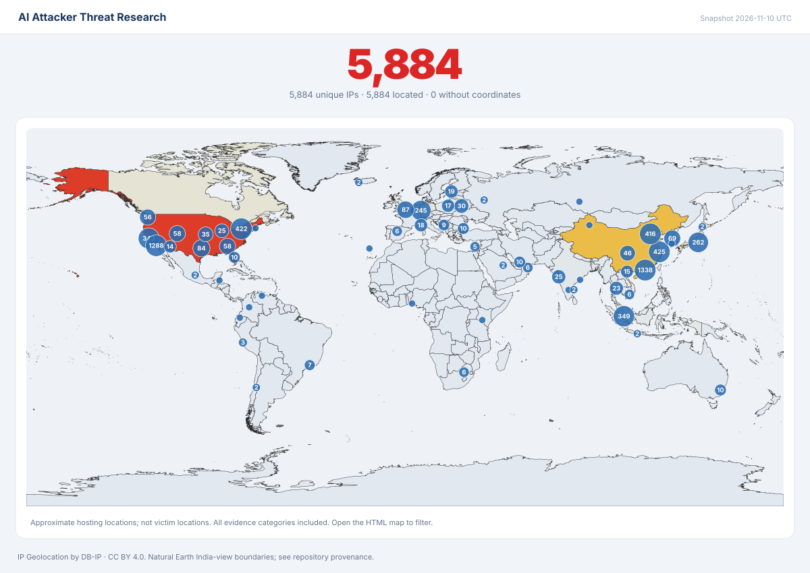

# IP evidence map



The [interactive map](index.html) contains the complete unique-IP inventory, evidence filters, a searchable table, source references and CSV export. GitHub displays an HTML file as source; download `index.html` and open it in a browser to use the interactive view. The single file works from `file://` without an API key, external scripts, map tiles or an internet connection. If this repository is served through an existing static site, the same file can be opened there.

All evidence categories are selected initially. Numbered markers aggregate nearby estimated locations and count unique addresses. Some IPs have several roles or memberships; a shared marker is not a claim that its members belong to the same campaign. Addresses without coordinates remain in the total, table and CSV. Zero latitude/longitude is retained only when actually present in the source data.

The India C2 shortcut requires `india_campaign_c2_supported=true`, computed from C2 and India campaign evidence in the **same** original source record. Other address membership filters can combine associations from different original records and do not establish that those observations came from one campaign.

Filters cover evidence category, framework/research corpus, India targeting scope, estimated hosting country, C2 role, our derivations and minimum confidence rubric score. A search also matches IP, ASN, network name, city, campaign and source record IDs. Activate a marker or IP for the full evidence details and original source references. The table shows 100 rows per page; **Download selected CSV** exports every selected address, including those on other pages and without coordinates. Exported text cells beginning with spreadsheet formula characters receive a leading apostrophe for safe viewing; authoritative canonical values remain in `data/ip-overview.json`.

Use **Zoom +**, **Zoom −** and **Reset map**, or focus the map and use plus/minus, arrow keys and Home. Markers work with Enter or Space. The table provides access to the same data without map interaction.

Approximate hosting location is not victim location or evidence of Indian targeting. The announcing network/ASN organization does not identify the operator, customer or verified hosting vendor. Enrichment describes the selected provider snapshot; it does not reconstruct attack-time location or ownership. Confidence scores summarize an evidence rubric, not a probability of maliciousness. Passive deployment leads, legitimate/shared services and unresolved findings must not become an automatic block list.

## Sources and boundaries

[IP Geolocation by DB-IP](https://db-ip.com) is used under [CC BY 4.0](https://creativecommons.org/licenses/by/4.0/). DB-IP Lite is a reduced-coverage/accuracy monthly product. The IP overview documents the actual downloaded release and hash, ASN data sources and scoring rules. The map does not perform live lookups or test whether any service is currently reachable.

The world geometry uses **Natural Earth India point of view**, sourced through [geojson-regions at a pinned commit](https://github.com/AshKyd/geojson-regions/tree/cb0234d2e0a0bf392b79f742a6c2c8d9ca35e488/static/countries/pov/ind/10m), rather than the default Natural Earth boundary viewpoint. Natural Earth source data is public domain. The reviewed local asset preserves India's requested territorial depiction and is simplified for display; it is not a Survey of India certified map. Geography depicts countries and territories without making each feature an official sovereignty/recognition assertion. Full provenance and territorial-anchor checks are in the geometry asset metadata under `maps/assets/`. The original dataset scale is 1:10 million; “10m” does not mean 10-metre resolution.

`render-metadata.json` records input/geometry hashes, counts, timestamp, any additional display simplification and rendering limits. The reviewed simplified asset is used unchanged by the renderer's default settings.

## Rebuild

From the repository root, with Python 3.12 or later:

```text
python scripts/render_ip_map.py --root . --geometry maps/assets/world-india-view.geojson
```

The renderer uses only the Python standard library. It reads the canonical flat list in `data/ip-overview.json` and the locally reviewed GeoJSON, then writes `maps/index.html`, `maps/world.svg` and `maps/render-metadata.json`. No network access occurs. To reproduce byte-identical output, provide the same inputs and the prior UTC render timestamp:

```text
python scripts/render_ip_map.py --root . --geometry maps/assets/world-india-view.geojson --rendered-at 2026-11-10T18:00:00Z
```

Replace the example timestamp with the one recorded in the metadata being reproduced. Do not substitute unreviewed default-view boundary data. After rebuilding, update the repository's integrity manifest and run the offline validator as documented in the root contribution guide.
